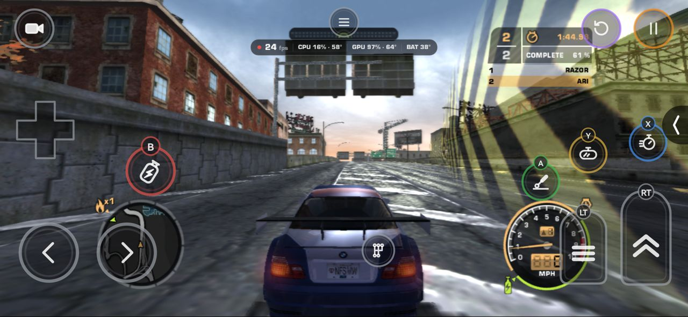
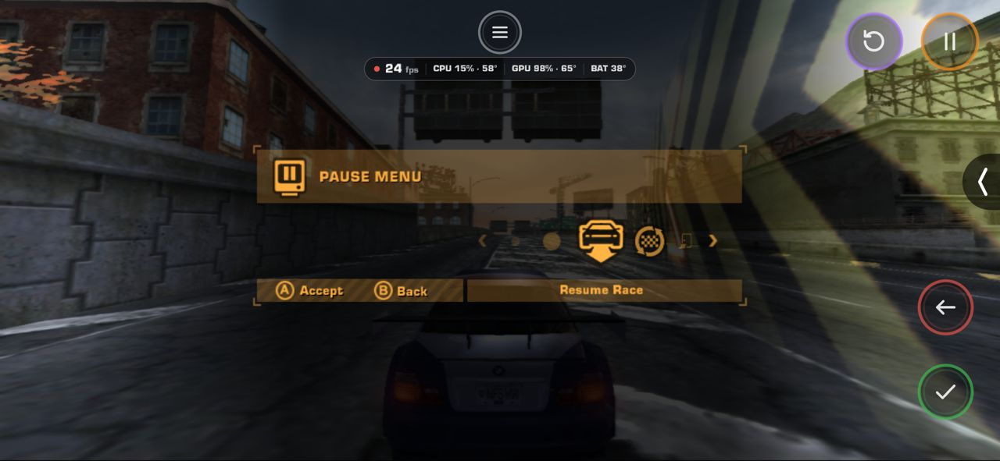
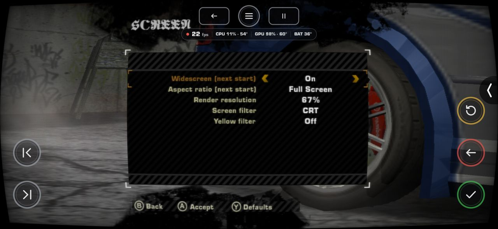
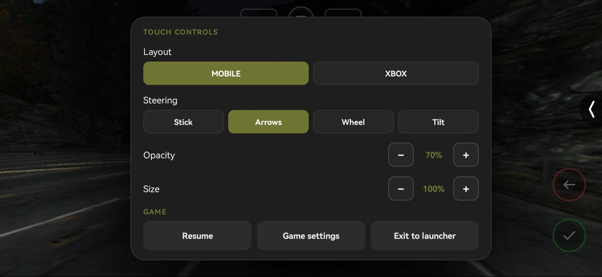
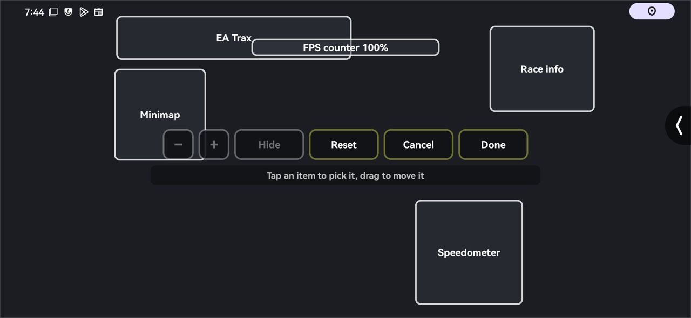
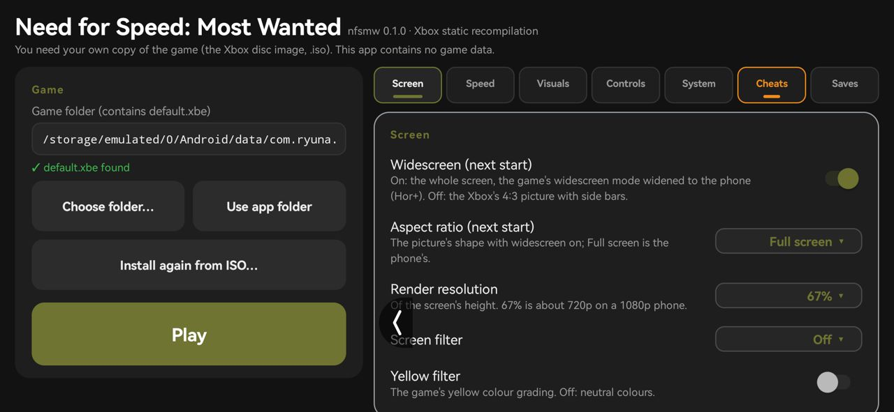
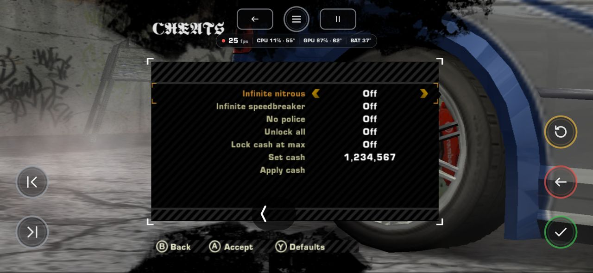

<div align="center">


# NFS Most Wanted (Xbox) for Android

**Need for Speed: Most Wanted (2005), the original Xbox release, natively on Android**

[](#-requirements)
[](#-requirements)
[](../../releases/latest)
[](../../actions/workflows/build.yml)
[](LICENSE)



</div>

> [!IMPORTANT]
> No game data is included. You need your own Xbox disc of *Need for Speed: Most Wanted Black Edition* (NTSC-U, title ID `0x4541007B`, `default.xbe` SHA-1 `f636a16af04171089f879a4bed646e185c734233`).

## 🧩 What this is
The engine is [MostWanted-Android](https://github.com/RanggaCasper/MostWanted-Android) by RanggaCasper: the game statically recompiled to arm64 with [XboxXBE-Recomp](https://github.com/TGP482/XboxXBE-Recomp), Direct3D 8 drawn with Vulkan, no emulator. His fixes and patches come with it (widescreen, the minimap, the HUD layout, the game's options), and the later ones are taken in as he makes them.

On top of it, this project is the phone side: its own launcher, touch controls, in-game settings, HUD editor, cheats and save slots.

The previous engine of this project (NV2A push buffers to Vulkan) is on the [`experimental-old`](../../tree/experimental-old) branch.

## 🚀 Quick start
1. Install the APK from [Releases](../../releases/latest).
2. Open **NFS Most Wanted**, tap **Install from ISO…** and pick the disc image. It is extracted once (about 2.9 GB).
3. Tap **Play**.

Settings, saves and logs are in `Android/data/com.ryuna.nfsmw2005x/files`.

## ✨ Features
- **Touch controls**: MOBILE (stick, arrows, wheel or tilt steering, pedals, NOS, gear lever) or a full Xbox pad, in their own ring design; move, resize and hide each one.
- **Menus by touch**: the game's prompts become icon buttons; tap the highlighted item, swipe through lists.
- **Settings in the launcher and in the game** (**Configuration** in the main and pause menus): Screen, Speed, Visuals, Controls, HUD, System, Cheats.
- **HUD editor**: move or hide the speedometer, minimap, race info, EA Trax and the FPS counter.
- **Cheats**: infinite nitrous and speedbreaker, no police, unlock all, set cash.
- **Save slots** with zip backup and restore.
- English and Indonesian. Controllers and keyboard work too.

| | |
|---|---|
|  |  |
|  |  |
|  |  |

## 📱 Requirements
Android 11+, arm64, a Vulkan 1.1 GPU (Adreno 6xx+, Mali-G7x+, Xclipse), 4 GB RAM, 4 GB free storage. Tested on a POCO M3 (Adreno 610).

## 🛠️ Building
Put `default.xbe` (or the disc image) in `assets/`, then on Linux:
```
scripts/build.sh            # debug APK
scripts/build.sh --release  # release APK
```
Needs CMake, Ninja, Clang, Java 17 and the Android SDK with NDK `28.2.13676358`. The first build recompiles the whole game (10–90 minutes).

A `v*` tag builds and publishes a release through GitHub Actions.

## 🙏 Credits
- [**RanggaCasper**](https://github.com/RanggaCasper): the engine, [MostWanted-Android](https://github.com/RanggaCasper/MostWanted-Android), and its fixes taken in here: split screen (`009b144`), the boot movies' crash (`6733577`), white car reflections at a race's start (`a8cb125`), a pursuit's boxes in the HUD editor (`b896442`).
- [**zetaxlinux**](https://github.com/zetaxlinux): Vulkan 1.1 hangs fixed (`c37fa36`).
- [**TGP482**](https://github.com/TGP482): [XboxXBE-Recomp](https://github.com/TGP482/XboxXBE-Recomp), the recompiler and runtime.
- Zukiru: the HDR screen filter.
- [SDL](https://github.com/libsdl-org/SDL), [glslang](https://github.com/KhronosGroup/glslang), [toml++](https://github.com/marzer/tomlplusplus), [Dear ImGui](https://github.com/ocornut/imgui).

*Need for Speed* is a trademark of Electronic Arts Inc. This project is not affiliated with or endorsed by them.
