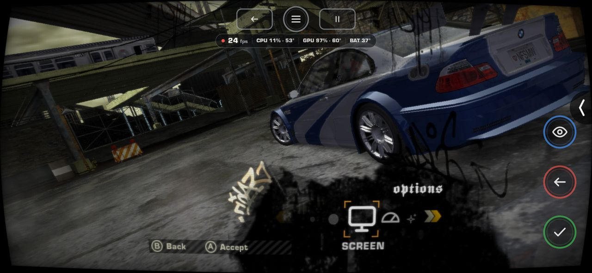
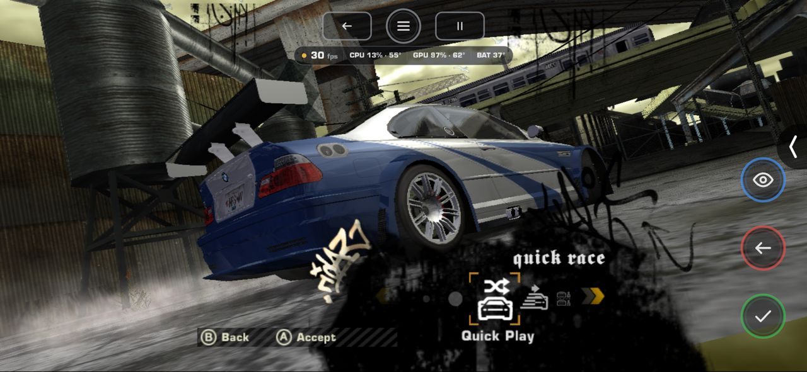
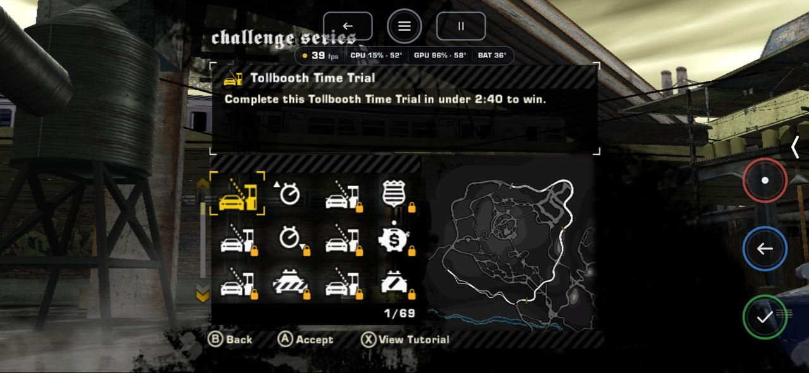
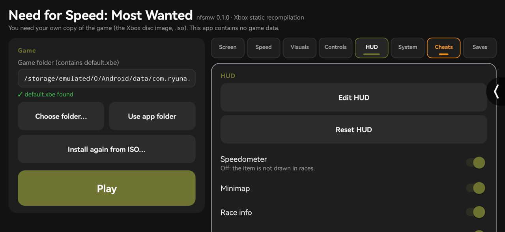
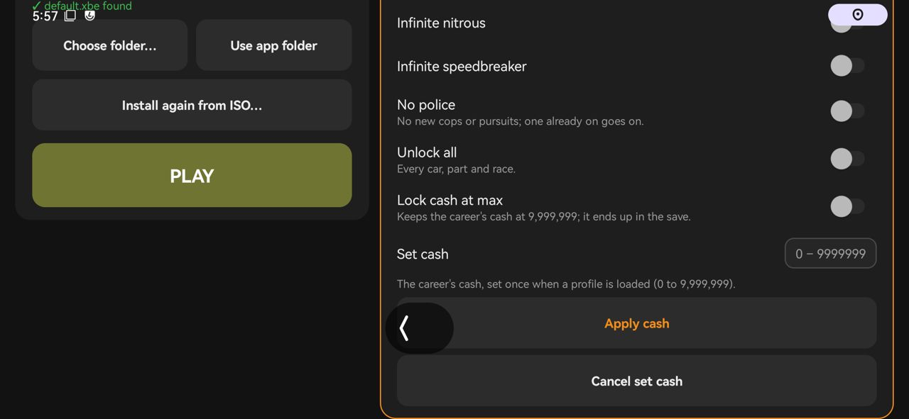
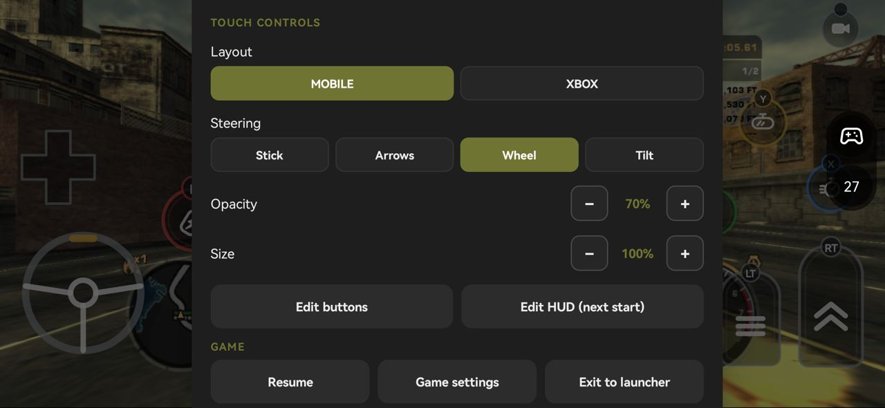
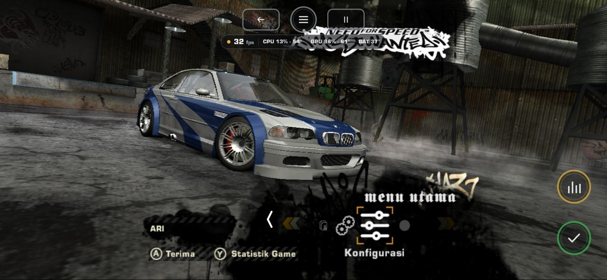

# Need for Speed: Most Wanted for Android
An unofficial native Android port of the original Xbox version of *Need for Speed: Most Wanted* (Black Edition), with touch controls made for phones, controller and keyboard support, settings in the launcher and in the game, a HUD editor, cheats and save slots.

The game's x86 code is statically recompiled ahead of time to C++ with [XboxXBE-Recomp](https://github.com/TGP482/XboxXBE-Recomp), then built for arm64. Drawing goes through Vulkan, and windowing, input and audio through SDL3. No emulator is involved. The engine (Vulkan renderer, Direct3D 8 and DirectSound on the host, the game's patches) comes from [MostWanted-Android](https://github.com/RanggaCasper/MostWanted-Android) by RanggaCasper (see [Credits](#credits)); the Android shell (launcher, ISO installer, touch controls and their editors, in-game settings, HUD editor, cheats, save slots) is this project's.

> [!NOTE]
> This project does not include the game's data. You must provide the files from your own legally acquired copy of the game to install or build. The one exception is `ci/default.xbe.enc`, the game's executable encrypted for the release workflow, which only builds with the repository's secret key.

> [!WARNING]
> Work in progress. See [Status](#status).

## Screenshots
Taken on a POCO M3 (Snapdragon 662, Adreno 610), full screen widescreen.

| | |
|---|---|
|  |  |
| Race, MOBILE controls (arrows steering) | Pause menu: restart and pause stay, the menu's Accept and Back as icons |
|  |  |
| **Configuration** in the game's menu | Its categories: Screen, swipe a row to change it |
|  |  |
| Menus: each prompt an icon button in the pad's colour | Challenge Series: Back, Accept, View Tutorial |
|  |  |
| The ☰ card pauses the race: layout, steering, opacity, size | **Edit HUD**: drag, hide, the FPS counter's size |
|  |  |
| Launcher: game folder, PLAY and the same categories as tabs | Launcher, HUD tab |
|  |  |
| Cheats in the game | Cheats in the launcher, with Set cash |
|  |  |
| Wheel steering | Indonesian: the game's menus translated |

## Installation
1. Install the APK (from [Releases](../../releases)).
2. Open **NFS Most Wanted** and tap **Install from ISO…**: pick the Xbox disc image (`.iso`). It is extracted once into `Android/data/com.ryuna.nfsmw2005x/files/game` (about 2.9 GB); the `.iso` can be deleted afterwards. A folder extracted on a PC (`default.xbe` with the disc's `NFS` folder beside it) works too: **Choose folder…** (asks for all files access).
3. Tap **Play**.

The settings (`mostwanted.toml`, shared by the launcher and the game, the HUD layout among them) are in `Android/data/com.ryuna.nfsmw2005x/files`; the shader cache and the logs (`logs`) are there too. Saves: see [Saves](#saves).

The supported disc is the USA Black Edition (`default.xbe` SHA-1 `f636a16af04171089f879a4bed646e185c734233`).

## Features
- **Widescreen**: Hor+ on the phone's own shape, the minimap and HUD in place.
- **Settings in two places, one file**: the launcher's tabs and **Configuration** in the game's main menu and pause menu (*Konfigurasi* in Indonesian) have the same categories (Screen, Speed, Visuals, Controls, HUD, System, Cheats), rows and order; a change in one shows in the other. In the game a sideways swipe on a row steps its value.
- **☰ card**: the ☰ at the top centre opens a card over the game that pauses a race first: touch layout and steering, opacity and size, Edit buttons, Edit HUD, the game's settings, Resume or back to the launcher.
- **Menus by touch**: each prompt the game shows (Accept, Back, Restart, Statistics, View Tutorial, Zoom, …) is an icon button in its pad button's colour, down the screen's sides; a tap on the highlighted item is A, a swipe steps through the list, the game's keyboard takes taps.
- **Background pause**: the game and its sound pause while the app is in the background. Android's back button is the controller's Start in a race (the pause menu) and B in the menus.

## Controls
Launcher tab **Controls**, and the game's Controls category.
- **Control mode**: **MOBILE** (steering, gas and brake pedals, nitrous, e-brake, speedbreaker, look back, a gear lever) or **XBOX** (the whole Xbox controller). The buttons are this port's own ring design, each in its pad button's colour with the button's letter on a badge.
- **Top row** (MOBILE): the camera top left, the ☰ in the middle, **restart** (Back, violet) and **pause** (Start, orange) top right. Restart and pause show in a race and its pause menu only; in the front end and loading screens only the ☰ shows.
- **Steering** (MOBILE): Stick, Arrows, Wheel (drag round it) or Tilt (turn the phone), with **Tilt sensitivity**.
- **Race / menu / neither**: the race controls show only in a race; in a menu its prompts replace them, and loading screens and fades show neither, so nothing flashes between menus.
- **Opacity** and **Size** of the current layout's buttons (Size scales every button over each one's own size from the editor), kept in `mostwanted.toml` (`touch_opacity_<mode>`, `touch_size_<mode>`) and shared by the launcher and the game.
- **Edit buttons**: move, resize, hide and fade each control.
- Launcher only: on-screen controller, hide with a controller, button feedback, vibration (with a test).
- **Controller**: any controller SDL3 supports, with rumble (the phone vibrates without one), each Xbox button remappable (**Controller mapping**). The touch controls hide while a controller is in use. **Keyboard** too.

## HUD
Launcher tab **HUD**, and the game's HUD category.
- **Edit HUD** (also on the ☰ card in the game, which pauses the race first): the speedometer, the minimap, the race information (with a pursuit's boxes), the EA Trax banner and the FPS counter as boxes over the game. Drag one to move it, **Hide** / **Show** it, and size the FPS counter with − / +. Opened in the game, the paused game shows behind the boxes and the HUD moves as soon as the editor closes, no restart. The game's own HUD keeps its size (its pieces do not scale together).
- **Reset HUD**: every item back where the game puts it, shown, and the FPS counter top centre at its size.
- **Speedometer**, **Minimap**, **Race info**, **EA Trax**: shown or hidden, at once.
- **FPS counter** (a pill with the frame rate, CPU and GPU load, temperatures and battery), **Counter position** (six places, or Custom where Edit HUD left it), **CPU/GPU usage**, **Temperatures**.

## Settings
| Category | Rows |
|---|---|
| Screen | Widescreen (Hor+ on the phone's shape; off, the Xbox's 4:3 with side bars), Aspect ratio, Render resolution (25% to 200% of the screen's height), Screen filter (Sharpen, Vivid, Scanlines, CRT, HDR), Yellow filter (the game's colour grading, off by default) |
| Speed | Preset (Saver, Balanced, Max), FPS cap (30 to 360, the display's refresh rate or unlimited), V-Sync, Shader preloading; in the launcher, Performance log |
| Visuals | Bloom, Fog, Motion blur, Car reflections (full, every 2nd or 4th frame, off), Road reflections, Shadows, Particles, Falling rain, Screen raindrops, Anti-aliasing (FXAA, SSAA 2x), Anisotropic filtering |
| Controls | See [Controls](#controls) |
| HUD | See [HUD](#hud) |
| System | Language (English, or Indonesian: the recompilation's text and the game's menus translated), Audio output (automatic, mono, stereo, 5.1), Skip movies, Active save slot, About |
| Cheats | See [Cheats](#cheats) |

A **Preset** sets the Speed and Visuals rows and the render resolution at once: **Saver** 50%, 30 fps, no reflections, motion blur or particles; **Balanced** 67%, 60 fps, the cars' reflections every 2nd frame; **Max** 100%, no cap, V-Sync, everything on, SSAA 2x and 16x anisotropic. A row changed afterwards shows the preset as Custom. A change in the launcher reaches the game at Play. In the game most rows apply at once; of the rows marked *(next start)*, Language takes effect at the next start, Audio output switches at once, and Shader preloading turned on starts preloading once during this run (turned off, it stops only at the next start).

## Cheats
Launcher tab **Cheats** (orange), and the game's Cheats category: infinite nitrous, infinite speedbreaker, no police (no new cops or pursuits; one already on goes on), unlock all, lock cash at max (9,999,999, kept in the save), and **Set cash** (0 to 9,999,999): set once when a career profile is loaded; in the launcher only while the game is not running, with Cancel. A save slot played with a cheat on is tagged **CHEATS ON** in Saves.

## Saves
Saves are slots in the game folder, `game/saves/<slot>` (`Main` by default; under `Android/data/com.ryuna.nfsmw2005x/files` for the ISO install). The launcher's **Saves** tab makes, selects, duplicates, renames and deletes slots, backs one up to a .zip and restores one from it; Play plays the selected slot, which the game's System category shows as Active save slot. Back up before uninstalling: Android removes `Android/data` with the app. Saves from builds before slots move into `Main` once.

## Status
Tested on a POCO M3 (Snapdragon 662, Adreno 610, Vulkan 1.1): boot, the movies, the menus, Quick Race and Challenge Series, pause and resume, widescreen with the minimap and HUD. The engine was tested by RanggaCasper on a Xiaomi Pad 7 (Snapdragon 7+ Gen 3), about 60 FPS in a race.

- `xbe_symbols` finds 165 of the 238 XDK functions the host knows and all 12 data symbols; the others are not linked into this image. Eleven more were resolved by hand in `config/game.toml`.
- Most Wanted runs many of its vertex programs from the GPU's program memory (`LoadVertexShaderProgram` and `SelectVertexShaderDirect`), pushes its vertex constants inline, sets its pixel combiners with render states and gives its own frame and depth buffers; the host handles each.
- Visibility tests (the sun's glare) are not counted yet: the glare stays off.
- Not tested yet on this build: long races (several minutes), pursuits, split screen, changing graphics settings in the middle of a race.

The previous engine (low-level NV2A push buffers to Vulkan, with the minimap and widescreen problems) is kept on the [`experimental-old`](../../tree/experimental-old) branch.

Logs are in `Android/data/com.ryuna.nfsmw2005x/files/logs`. Please include the log when reporting a problem.

## System Requirements
- **Android** 11 or newer, arm64.
- **GPU** with a Vulkan 1.1 driver, for example Adreno 6xx or newer, Mali-G7x or newer, or Xclipse.
- **Memory**: 4 GB.
- **Storage**: 4 GB for the game files and saves.

## Building
On Linux: `scripts/build.sh` (on Windows, `build.bat`).

1. Put `default.xbe` in `assets/` (or the disc image in `assets/` or `iso/`; `python3` extracts the xbe from it), or pass `--xbe <file>`.
2. Install CMake, Ninja, Clang, Java 17 to 21 and the Android SDK with Platform 36 and NDK `28.2.13676358` (`ANDROID_HOME`, default `~/Documents/Repos/Android/SDK`).
3. Run:
   ```
   scripts/build.sh                    # debug APK: app/build/outputs/apk/debug/app-debug.apk
   scripts/build.sh --release          # release APK, debug key unless BLACK_KEYSTORE is set
   scripts/build.sh --reuse-generated  # keep generated/game, skip the recompile
   ```
   It builds the recompiler, recompiles the xbe into `generated/game`, builds `libmain.so` with the NDK into `out/build/android` and packages the APK with Gradle. The first build compiles the whole game for arm64 (10 to 90 minutes).

Install the APK with `adb install -r app/build/outputs/apk/debug/app-debug.apk`.

The Linux host for benchmarking (`linux/`) builds from the same tree; its commands are at the top of `linux/CMakeLists.txt`.

The SDK is vendored in `sdk/`, at the upstream commit in `sdk/UPSTREAM_COMMIT`, with one change: the console's language comes from `app::ConsoleLanguage()` (`sdk/runtime/kernel/xboxkrnl.cpp`).

## Releases
GitHub Actions (`.github/workflows/build.yml`) builds the APK on Linux with `scripts/build.sh --release`:
- every push to `main`, and a run by hand (Actions > Build > Run workflow): the signed APK as the run's artifact, named `MostWanted-dev-<commit>.apk`;
- every `v*` tag: a release with the APK, its size and SHA-256, and the commits since the previous tag. To release:
  ```
  git tag v0.2.0
  git push origin v0.2.0
  ```

The workflow needs the repository secrets `XBE_KEY` (the passphrase of `ci/default.xbe.enc`, the game's executable encrypted) and, for the release signature, `KEYSTORE_BASE64`, `KEYSTORE_PASSWORD`, `KEY_ALIAS` and `KEY_PASSWORD` (without them the APK has a debug signature).

## Credits
- [XboxXBE-Recomp](https://github.com/TGP482/XboxXBE-Recomp) by TGP482: the static recompiler and the portable runtime (Xbox kernel, XDK libraries and Direct3D 8) this port is built on.
- [MostWanted-Android](https://github.com/RanggaCasper/MostWanted-Android) by [RanggaCasper](https://github.com/RanggaCasper): the engine this port runs on (the Android native host, the Vulkan renderer, Direct3D 8 and DirectSound on the host, the game's patches), carried over from his [Black-Android](https://github.com/RanggaCasper/Black-Android) and [ShaolinMonks-Android](https://github.com/RanggaCasper/ShaolinMonks-Android). His later fixes to the engine taken in since:
  - `native/vulkan.cpp` as of his `05c5b7a`: split screen drawn under the HUD (`009b144`), and with it [zetaxlinux](https://github.com/zetaxlinux)'s Vulkan 1.1 submit and fence failures handled instead of hanging (`c37fa36`);
  - the boot movies' crash, a stream read before its block was set (`6733577`);
  - the cars' reflection white at a race's start when not FULL (`a8cb125`);
  - a pursuit's boxes left behind when the race information is moved in the HUD editor (`b896442`).
- Zukiru: the HDR screen filter.
- [SDL](https://github.com/libsdl-org/SDL), [glslang](https://github.com/KhronosGroup/glslang), [toml++](https://github.com/marzer/tomlplusplus) and [Dear ImGui](https://github.com/ocornut/imgui).
- [xemu](https://github.com/xemu-project/xemu) and [Cxbx-Reloaded](https://github.com/Cxbx-Reloaded/Cxbx-Reloaded), which XboxXBE-Recomp used as references for Xbox hardware and API behavior.

*Need for Speed* is a trademark of Electronic Arts Inc. This project is not affiliated with or endorsed by them.
