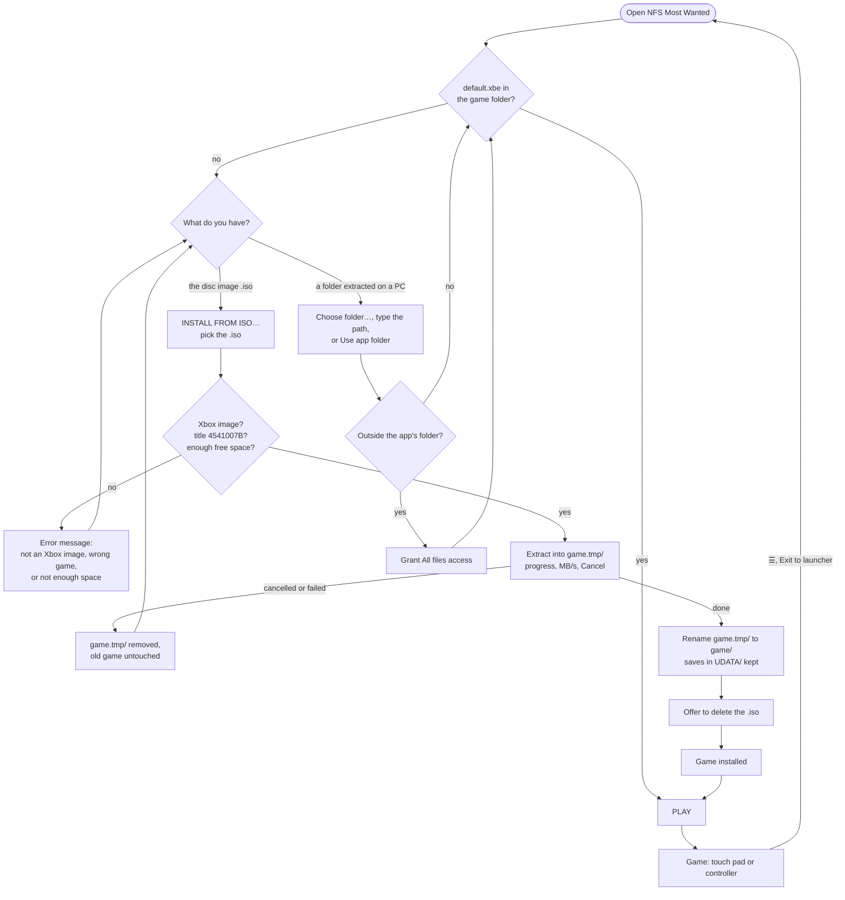
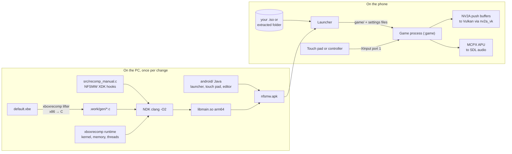

<div align="center">


# NFS Most Wanted (Xbox) for Android

**Need for Speed: Most Wanted (2005), the original Xbox release, natively on Android**

The Xbox (NTSC-U, Black Edition) release of Need for Speed: Most Wanted,
lifted instruction by instruction from the XBE to C and compiled for arm64
phones. No emulator: the game's own code runs on the phone's CPU, its NV2A
GPU commands are drawn with Vulkan, and its APU is mixed into Android audio.
Built on the [Burnout 3 port](https://github.com/aribrilliantsyah/Burnout3-Recompiled-Mobile)'s
Android shell and renderer.

[](#-devices)
[](#-how-it-works)
[](#-quick-start)
[](#-status)
[](LICENSE)

<p align="center">
  <a href="#-status">Status</a> •
  <a href="#-quick-start">Quick start</a> •
  <a href="#-features">Features</a> •
  <a href="#-controls">Controls</a> •
  <a href="#-devices">Devices</a> •
  <a href="#%EF%B8%8F-building">Building</a> •
  <a href="#-credits">Credits</a>
</p>

</div>

---

> [!IMPORTANT]
> **No game data is included, and none ever will be.** The APK carries only
> the recompiled engine. You need your own copy of the Xbox disc (NTSC-U,
> title ID `0x4541007B`).

## 🚦 Status

Bring-up. The shell (launcher, ISO install, touch pad and editor, controller
mapping, FPS overlay) and the Vulkan renderer with its Mali/Adreno fixes are
the Burnout 3 port's, which runs on a Mali-G68 and an Adreno 610. The game
side is new: the XDK hooks are in (see
[docs/research/nfsmw-re.md](docs/research/nfsmw-re.md)); boot on the phones
is the next step. Screenshots come once it runs on a phone.

## 🚀 Quick start

1. **Install the APK** and open **NFS Most Wanted**.
2. **Give it the game**, one of two ways:
   - **From the disc image**: copy your `.iso` (Need for Speed: Most Wanted,
     Xbox NTSC-U, ~2.9 GB) to the phone, tap **INSTALL FROM ISO…** and pick
     it. The launcher checks it, extracts it once into the app's folder and
     offers to delete the `.iso`.
   - **Already extracted on a PC**: copy the folder (the one with
     `default.xbe` and `NFS/`) to the phone and point the launcher at it, or
     put it in `Android/data/com.ryuna.nfsmw2005x/files/game/` and tap
     **Use app folder**.
3. **PLAY.**



## ✨ Features

- **Native, not emulated**: about 28,400 lifted functions compiled with
  clang `-O2`.
- **Vulkan renderer for any phone**: Vulkan 1.3 path for current drivers,
  automatic Vulkan 1.1 path (render passes, descriptor sets, baked pipeline
  state) for older ones such as Mali r32p1 and Adreno 512.
- **Up to 60 fps**: the title asks for a 2-vblank flip in races (30 fps);
  the flip is taken on the next vblank (`NFSMW_FPS_CAP=30` keeps the
  original).
- **Two touch layouts**, the same mechanics as the Burnout 3 port:
  - *Drive*: steering stick (or ◀ ▶ arrows, or tilt), GAS and BRAKE
    pedals, a big NOS button over the pedals with E-BRAKE, Speedbreaker and
    look-back around it, D-pad (shop, Blacklist, map, SMS), camera.
  - *Full*: the complete original Xbox controller.
- **Layout editor**, **controller mapping**, **in-game ☰ menu**, **Show
  FPS**, **install from ISO**, **debug log**: as in the Burnout 3 port.

## 🎮 Controls

NFSMW's own Xbox controls:

| Xbox | Driving | Menus |
|---|---|---|
| RT | Accelerate | |
| LT | Brake / reverse | |
| Left stick | Steer | Highlight |
| Right stick | Shift up / down (manual) | |
| A | E-brake | Select |
| B | Nitrous | Back |
| X | Speedbreaker | |
| Y | Look back | |
| Black | Change camera | |
| D-pad | Up: shop, Down: Blacklist, Left: map, Right: SMS | Highlight |
| Start | Pause | |

**Overlay buttons** (top centre, fade after 4 s, a tap brings them back):
☰ menu, **DRIVE/FULL** switch layout, **HIDE/TOUCH** hide the pad, ⚙ edit
layout.

## 📱 Devices

| Device | SoC / GPU | Driver | Result |
|---|---|---|---|
| Infinix X6815D (Android 13) | Dimensity 920 class, Mali-G68 MC4 | Mali r32p1, Vulkan 1.1 | ⏳ to test (Burnout 3: ✅) |
| POCO M3 (Android 15) | Snapdragon 662, Adreno 610 | Adreno 512.658, Vulkan 1.1 | ⏳ to test (Burnout 3: ✅) |
| Linux desktop (dev host) | any Vulkan GPU | RADV, lavapipe | ⏳ |

Requirements: Android 11 (API 30) or newer, arm64-v8a, Vulkan 1.1.

## 🧩 How it works



How the hooks were found (byte matching against Burnout 3's XDK 5849
libraries, NV2A register scans of the D3D section):
[docs/research/nfsmw-re.md](docs/research/nfsmw-re.md).

## 🛠️ Building

<details open>
<summary><b>1. Extract the disc and lift the XBE to C</b></summary>

```sh
python3 -m venv .work/venv && .work/venv/bin/pip install -r tools/requirements.txt
(cd xboxrecomp && ../.work/venv/bin/python -m tools.xiso unpack -o ../roms/game "../roms/<disc>.iso")
tools/regen.sh          # roms/game/default.xbe -> .work/gen/
```

</details>

<details open>
<summary><b>2a. Android</b> (NDK r28c, SDK 36)</summary>

```sh
export ANDROID_HOME=~/Android/Sdk
scripts/android/nfsmw.sh deps         # SDL2 + glslang for arm64 (once)
scripts/android/nfsmw.sh native apk   # libmain.so, then the APK
scripts/android/nfsmw.sh install run log
```

</details>

<details>
<summary><b>2b. Linux</b> (SDL2 + Vulkan)</summary>

```sh
cmake -S . -B build/linux-vk -G Ninja -DNFSU2_VULKAN=ON -DNFSU2_GEN_DIR=$PWD/.work/gen
cmake --build build/linux-vk -j3
NFSU2_GAME_DIR=$PWD/roms/game build/linux-vk/b3_recomp
```

</details>

<details>
<summary><b>3. Release</b></summary>

Same flow as the Burnout 3 port: `scripts/android/keystore.sh` once, then
`scripts/release.sh patch|minor|major`. See [docs/RELEASING.md](docs/RELEASING.md).

</details>

## ⚙️ Configuration

Launcher settings are written to `nfsmw_launcher.txt`; anything else goes
in `nfsmw_env.txt` in `Android/data/com.ryuna.nfsmw2005x/files/`, one
`KEY=VALUE` per line. The renderer variables are the Burnout 3 port's
(`RECOMP_VK_LEGACY`, `RECOMP_WIDESCREEN`, `RECOMP_GL_SCALE`, ...), plus:

| Variable | Meaning |
|---|---|
| `NFSMW_FPS_CAP=30` | Keep the title's 30 fps flip interval in races. |
| `NFSMW_LOG_FILE=1` | Write `nfsmw_log.txt` (the launcher's Debug log). |

## 📂 Project layout

```
nfsw-recompiled-mobile/
├── android/app/src/main/java/com/ryuna/nfsmw2005x/
│   ├── LauncherActivity.java     # launcher: folder, ISO install, settings, PLAY
│   ├── GameActivity.java         # the game (SDLActivity), ☰ menu, rumble
│   ├── TouchControllerView.java  # Drive/Full touch pad + its editor
│   ├── EditorActivity.java, GamepadMapActivity.java
│   └── Settings.java, UiKit.java, XisoExtractor.java
├── src/
│   ├── android_main.c            # SDL_main on Android, env, JNI
│   ├── main.c                    # boot, entry 0x2B3916
│   └── recomp_manual.c           # NFSMW XDK hooks
├── examples/burnout3/            # Burnout 3's hooks and notes, for reference
├── tools/regen.sh                # XBE -> .work/gen/*.c (never committed)
├── tools/xdk_match.py            # find a reference title's XDK functions
├── tools/find_disp.py            # find functions by the registers they touch
├── xboxrecomp/                   # the toolkit (Burnout 3 port's copy)
├── docs/research/nfsmw-re.md     # hooks and how they were found
└── roms/                         # your disc and its extraction (git-ignored)
```

## 🙏 Credits

- [sp00nznet/xboxrecomp](https://github.com/sp00nznet/xboxrecomp): the
  toolkit (MIT).
- [antoxa2584x](https://github.com/antoxa2584x): the Burnout 3, NFSU2 and
  Carbon ports (Carbon = the MW engine; its hook map guided this one).
- [victorgbd/NFSMW-Recompiled-Mobile](https://github.com/victorgbd/NFSMW-Recompiled-Mobile):
  the icon, the colour scheme and the touch layout model (Xbox 360 port).
- [SDL2](https://libsdl.org), [glslang](https://github.com/KhronosGroup/glslang).

Need for Speed: Most Wanted is © Electronic Arts. This project is not
affiliated with EA and contains none of their data.

## 📜 License

[MIT](LICENSE), as the projects it is built on.
