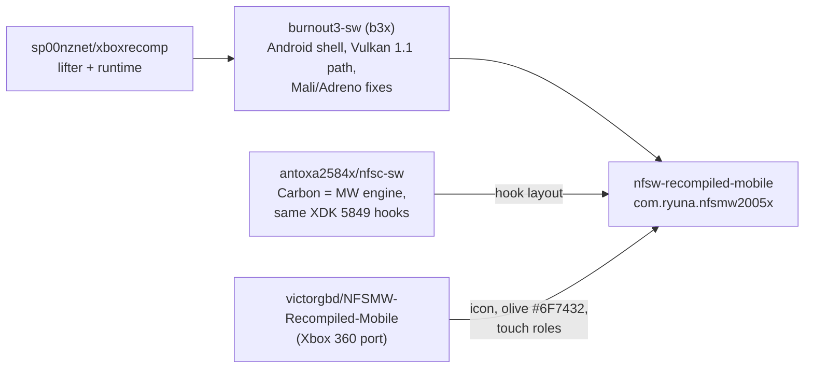

# NFSMW (Xbox) reverse engineering notes

Disc: *Need for Speed - Most Wanted - Black Edition (USA).iso* (2.9 GB,
21 files: `default.xbe`, `update.xbe`, `dashupdate.xbe`, `NFS/`).

| | |
|---|---|
| Title ID | `0x4541007B` (checked by the launcher's ISO installer) |
| Build | 2005-10-21, `NfsMWCollectorsRelease.exe` (Black Edition) |
| XDK | 5849 (D3D8, DSOUND flags 0x400B, XPP, XONLINES) |
| Image | base 0x10000, size 0x4F8040, entry 0x002B3916 |
| Sections | .text 0x11000, D3D 0x3714E0, XGRPH, XNET, XONLINE, DSOUND 0x3B65A0, XPP 0x3C0E00, .rdata, .data 0x41E7E0, DOLBY |

## Where this port comes from

- The Xbox side (lifter, runtime, NV2A Vulkan renderer with the Vulkan 1.1
  fallback for Mali-G68 r32 / Adreno 610) is Burnout 3's port unchanged.
- The hooks follow Carbon's port (antoxa2584x/nfsc-sw), which runs the same
  engine and the same stock D3D8 (not Burnout's D3D8LTCG).
- Only the look comes from the Xbox 360 Android port: icon, accent colour,
  touch roles. Its code (ReXGlue, PowerPC) is unrelated.

## Hooks: how each one was found

Two tools in `tools/` (both need the capstone venv):

- `xdk_match.py REF.xbe TARGET.xbe --names list.txt` masks absolute
  addresses and branch displacements out of a reference function and
  searches the target for the rest. Burnout 3's XBE is the reference (same
  XDK 5849 DSOUND and CRT).
- `find_disp.py XBE SECTION 0x...` lists the functions of a section that use
  given immediates or displacements, e.g. the NV2A registers a D3D handler
  touches. Function bounds come from `tools.disasm`'s functions.json.

| Hook | NFSMW | How found |
|---|---|---|
| memmove x2 | 0x317170, 0x31A1C0 | xdk_match, B3 0x2442A0 first 64 bytes, 2 hits (as Carbon) |
| _ftol2 | 0x31798C | xdk_match, unique (not overridden yet; native leaf later) |
| D3D BlockOnTime | 0x374020 | `ret 8` + reads device +0x2C/+0x30 + waits on device+0x1DCC |
| D3D device global | 0x381DE8 | first load of BlockOnTime |
| D3D vblank | 0x37C6F0 | find_disp: +0x1BC, +0x1C0, PCRTC 0x600100 |
| D3D PGRAPH | 0x37CC60 | find_disp: 0x400108/0x400704/0x400708 (NSOURCE, TRAPPED_ADDR/DATA) |
| DSOUND DSP post | 0x3B9139 | xdk_match, unique |
| DSOUND EP watchdog | 0x3B98BB from 0x3B9B9F | find_disp 0xCCCCCC / pointer 0x3C0B70 = 0xFE85A018 |
| AC97 reset | 0x3BF8CC, table 0x3C0518 | xdk_match, unique; body read to fix return addresses |
| DSOUND lock/unlock | 0x3B65D0 / 0x3B65F2 | xdk_match, unique |
| AC97 re-arm | 0x3BF6D6 | xdk_match, unique |

vblank to PGRAPH is 0x570 bytes apart, as in Carbon (0x362050 / 0x3625C0):
the same D3D build.

## Not done yet (needs a run, first on Linux, then the phones)

- First boot on Linux (`build/linux-vk`, lavapipe headless), then
  `[ICALL] Failed` / `[STUB]` triage and seeds into config/seed_functions.json.
- Carbon's other fixes worth checking on MW: the D3DX tiled-aperture fold
  (0xF0000000; Switch only, Android maps the aperture), the HUFF/JDLZ
  decompressor flag joins (the toolkit already has `_materialised_joins`),
  linear-texture full hash (EA logo movie), depth clamp for the FE car
  reflection floor.
- In-game picture options rows (Carbon's FeOptionsScreen map is the guide).
- Native leaves (_ftol2 at 0x31798C, the frustum/box math) for speed.
